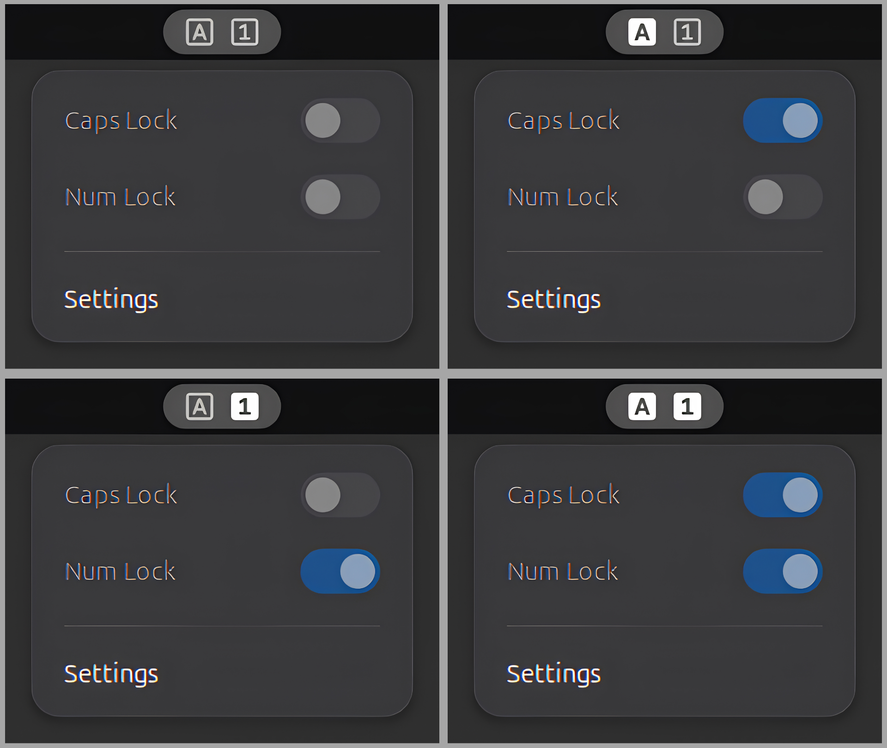
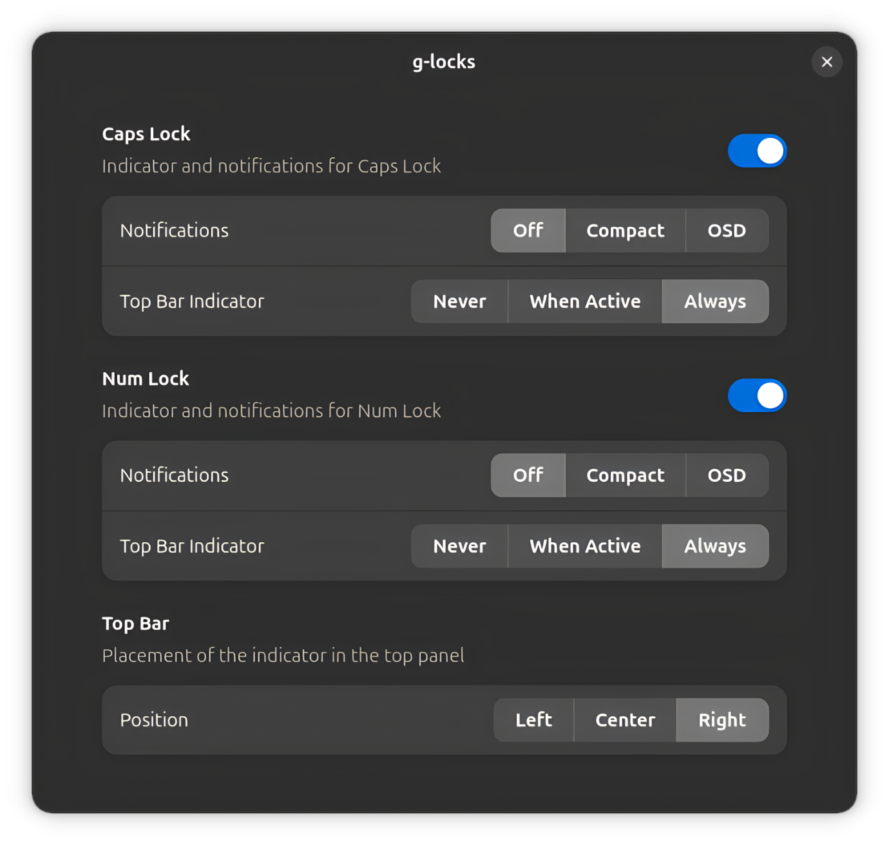

<div align="center">

# g-locks ⌨️

> *Minimal, Native Lock-Key Indicators & OSD Notifications for GNOME Shell*

<!-- follow me on linkedin -->
<a href="https://www.linkedin.com/comm/mynetwork/discovery-see-all?usecase=PEOPLE_FOLLOWS&followMember=george-ezat" target="_blank">
    
</a>
<!-- follow me on github -->
<a href="https://github.com/george-ezat" target="_blank">
    
</a>
<!-- repo stars -->

<!-- repo last update -->

<!-- repo license -->


</div>

---

## Overview

**g-locks** is a lightweight, modern, and native lock-key indicator extension for GNOME Shell (v47+). Designed to stay invisible until you need it and unmistakable when active, it brings crisp top-bar status indicators and native GNOME OSD notifications for **Caps Lock** and **Num Lock**, built cleanly for Wayland with zero polling.

<div align="center">
    
    
</div>

---

## Features

- **Smart Top Bar Indicators**
    - Crisp, monochrome symbolic icons (`A` and `1`) that blend natively into the GNOME top panel and adapt to light/dark themes.
    - Configure each key independently to show **Never**, **When Active** (zero clutter when off), or **Always**.
    - Quick status popup menu displaying live Caps Lock and Num Lock states with direct access to Settings.
- **Native Notifications**
    - **OSD:** Native GNOME Shell On-Screen Display popups matching your volume and brightness overlays.
    - **Compact:** Clean, transient notification banners that never pile up in your message tray.
    - **Off:** Silent mode when you only want top-bar feedback.
- **Flexible Placement & Laptop-Friendly Controls**
    - Place the indicator on the **Left**, **Center**, or **Right** of the top bar.
    - Independent master switches for **Caps Lock** and **Num Lock** (easily disable Num Lock on tenkeyless laptops).
- **Modern libadwaita Preferences**
    - Clean, one-click segmented controls for instant configuration, no nested menus or clutter.
- **Zero-Polling Wayland Architecture**
    - Strictly event-driven via `Clutter.Keymap`, keeping CPU and memory usage negligible.

---

## Installation

### Method 1: GNOME Extension Manager (Recommended)
1. Download `g-locks.zip` from the [Latest Release](https://github.com/george-ezat/g-locks/releases/latest).
2. Open the **Extension Manager** app (available on Flathub or your distribution's software center).
3. Click the menu icon (three dots or hamburger) and select **Install from file...**
4. Select the downloaded `g-locks.zip` file.

### Method 2: Command Line
1. Download `g-locks.zip` from the [Latest Release](https://github.com/george-ezat/g-locks/releases/latest).
2. Open your terminal and run:
    ```bash
    gnome-extensions install /path/to/your/downloaded/g-locks.zip
    ```
3. Log out and log back in (Wayland), or restart GNOME Shell (`Alt+F2`, type `r`, and press `Enter` on X11).
4. Enable the extension:
    ```bash
    gnome-extensions enable g-locks@george-ezat.github.io
    ```

### Building from Source
```bash
git clone https://github.com/george-ezat/g-locks.git
cd g-locks
./pack.sh
gnome-extensions install --force g-locks.zip
```

---

## Usage & Configuration

Once installed and enabled, **g-locks** immediately begins tracking Caps Lock and Num Lock state changes.

* Click the top bar indicator to view live lock-key states or open **Settings**.
* Or open preferences directly from the terminal:

    ```bash
    gnome-extensions prefs g-locks@george-ezat.github.io
    ```

---

## Troubleshooting

- Ensure you are running **GNOME Shell 47 or later**.
- If the extension does not appear after installation on Wayland, log out and log back in once so GNOME Shell discovers the new extension and compiled schema.
- If the **Top Bar Position** setting does not move the indicator, check whether you have a panel organizer extension (such as *Top Bar Organizer*) installed, it manages panel placement and takes priority.
- Verify the UUID is `g-locks@george-ezat.github.io` and check logs with `journalctl -f -o cat /usr/bin/gnome-shell`.
- Check the [GitHub Issues](https://github.com/george-ezat/g-locks/issues) page for known problems or to report a new one.

---

## Contributing

Contributions, bug reports, and feature requests are welcome! Please open an issue or submit a pull request on [GitHub](https://github.com/george-ezat/g-locks).

---

## License

This project is licensed under the GNU General Public License v2.0. See the [LICENSE](./LICENSE) file for details.

---

## Author & Support

Created and maintained by **[George Ezzat](https://github.com/george-ezat)**. For questions, suggestions, or support, please use the [GitHub Discussions](https://github.com/george-ezat/g-locks/discussions) or connect via [LinkedIn](https://www.linkedin.com/comm/mynetwork/discovery-see-all?usecase=PEOPLE_FOLLOWS&followMember=george-ezat).

---